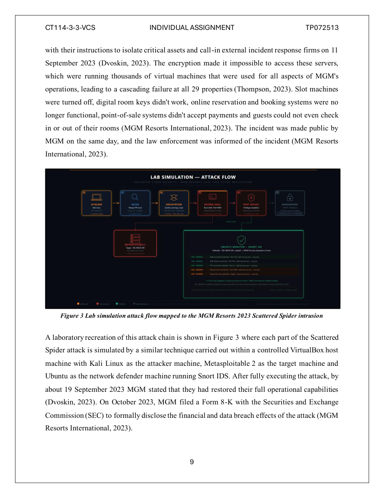
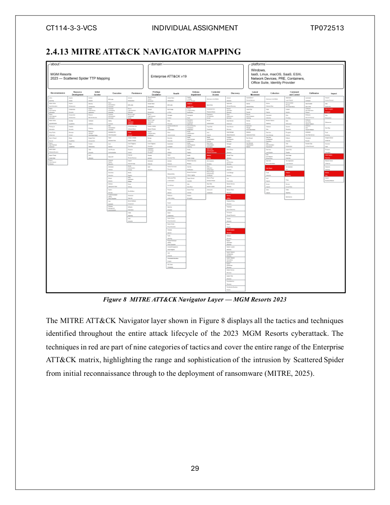
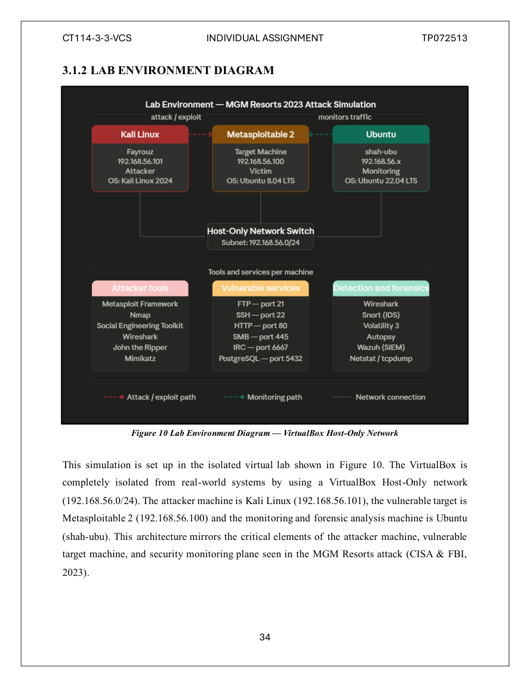
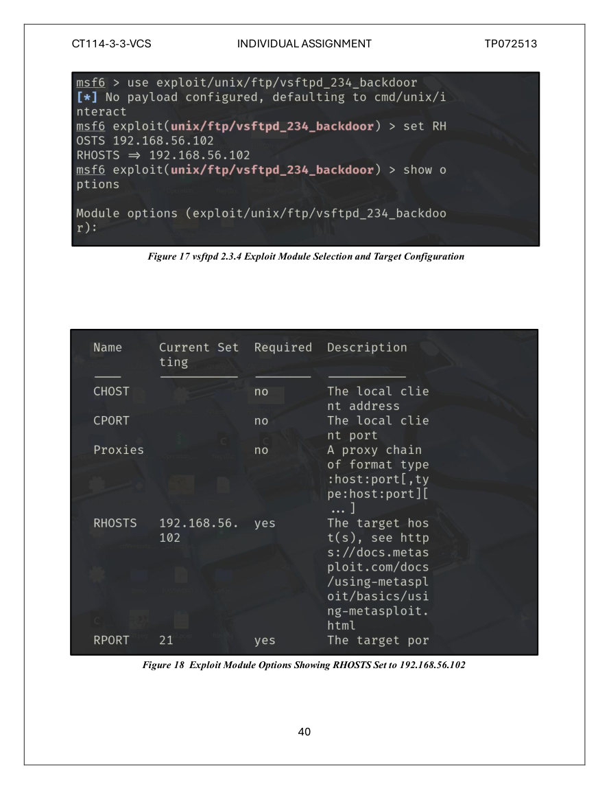
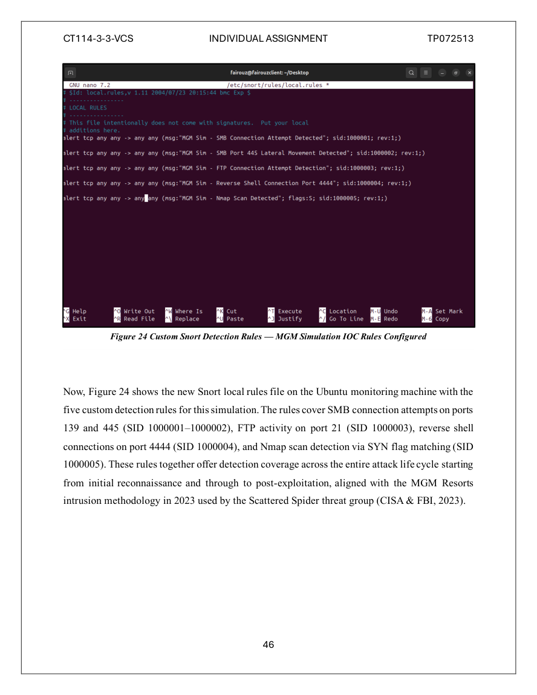
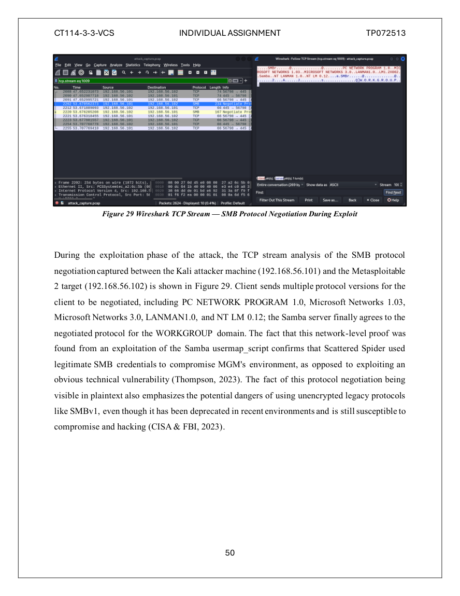
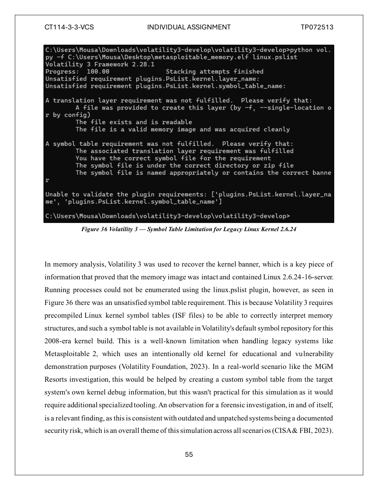
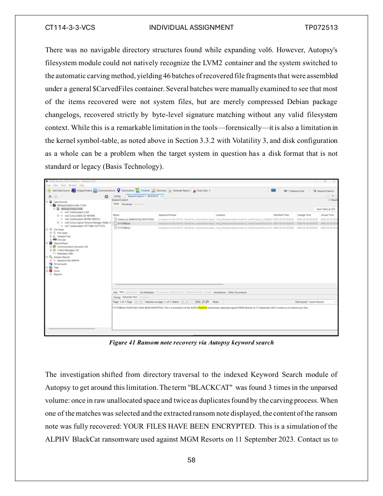

# MGM Resorts Cyberattack (2023) — Threat Intelligence, Lab Simulation & Digital Forensics

**Individual Advanced Cyber Security Project | Asia Pacific University (APU) | 2026**

> A structured investigation of the 2023 MGM Resorts ransomware incident, paired with an **isolated, authorized educational lab** demonstrating network exploitation, intrusion detection, forensic examination, and incident response planning. The lab is an analogous security exercise **not a reproduction of MGM’s actual identity compromise or ransomware deployment**.

## Project overview

This project combines two complementary components:

1. **Cyber Threat Intelligence:** Examination of the MGM Resorts incident, reported threat actors, attack lifecycle, operational consequences, indicators of compromise, and defensive lessons, with tactics mapped to the MITRE ATT&CK framework.
2. **Practical Security Lab:** A VirtualBox-based environment using Kali Linux, Metasploitable 2, and Ubuntu with Snort IDS, followed by network, memory, and disk forensic analysis and a documented incident response playbook.

The complete **75-page academic report** is available here: [MGM Resorts Cyberattack Case Study (PDF)](MGM-Resorts-Cyberattack-Case-Study.pdf).

## At a glance

| Area | Focus |
| --- | --- |
| Case study | MGM Resorts International cyberattack, September 2023 |
| Threat intelligence | Scattered Spider, ALPHV/BlackCat, social engineering, identity compromise |
| Framework | MITRE ATT&CK tactics and techniques; Diamond Model |
| Lab environment | Oracle VirtualBox, Kali Linux, Metasploitable 2, Ubuntu |
| Detection | Snort IDS, traffic monitoring, indicators of compromise |
| Forensics | Wireshark, Volatility, Autopsy |
| Response | Incident response plan, cyber playbooks, preventive controls |

## 1. Incident analysis

The research investigates how a socially engineered identity compromise can escalate into widespread enterprise disruption. The report examines reported helpdesk impersonation, authentication and cloud identity abuse, lateral movement, ransomware impact, and the resulting operational, financial, reputational, and regulatory consequences.

### Attack lifecycle and ATT&CK mapping





The threat-intelligence portion documents reconnaissance, initial access, persistence, privilege escalation, defense evasion, credential access, discovery, lateral movement, exfiltration, and impact. The mappings are case-study analysis, **not a claim that every reported technique was personally observed in the lab**.

## 2. Controlled security lab

### Environment

- **Kali Linux:** security assessment and simulated attacker workstation
- **Metasploitable 2:** intentionally vulnerable target VM
- **Ubuntu + Snort:** monitoring and intrusion detection
- **Oracle VirtualBox:** isolated virtualized infrastructure



### Practical assessment

The report documents controlled reconnaissance, a vulnerable Samba-service exploitation exercise against Metasploitable 2, and validation of the resulting lab session. This is an **educational demonstration against an intentionally vulnerable machine**, not an attack against MGM Resorts or a production environment.



## 3. Intrusion detection and forensic analysis

### Snort intrusion detection

Snort was used as the network monitoring component, with detection logic and alert evidence documented in the report.



### Wireshark network forensics

Captured traffic was inspected to investigate connections, relevant protocols, and indicators associated with the simulated activity.



### Volatility memory forensics

Memory analysis was explored as a means of investigating volatile evidence from the virtualized environment.



### Autopsy disk forensics

Disk forensics was included to inspect file-system artifacts and demonstrate a broader evidence-collection workflow.



## 4. Incident response and defensive recommendations

The report develops incident response procedures, a cyber playbook, malware-specific response guidance, and a prevention plan. Key defensive themes include:

- Stronger identity verification for sensitive helpdesk requests and MFA resets
- Monitoring identity-provider trust changes and privileged-account activity
- Segmentation and tighter control of administrative access across environments
- Network and endpoint detection, forensic evidence preservation, and incident escalation
- Tested recovery procedures, backups, and coordinated containment actions

## 5. Skills demonstrated

`Cyber Threat Intelligence` · `MITRE ATT&CK` · `Threat Modeling` · `Network Security` · `Vulnerability Assessment` · `Snort IDS` · `Wireshark` · `Memory Forensics` · `Disk Forensics` · `Incident Response` · `Technical Reporting`

## 6. Repository contents

```text
MGM-Resorts-Cyberattack-Security-Analysis/
├── README.md
├── MGM-Resorts-Cyberattack-Case-Study.pdf
├── attack-flow.png
├── mitre-attack-mapping.png
├── lab-topology.png
├── attack-simulation.png
├── snort-detection.png
├── wireshark-forensics.png
├── volatility-forensics.png
└── autopsy-forensics.png
```

The images above are **page previews extracted from the submitted report**, preserving the original documentation and figure context. The repository includes documentation and visual evidence; it does not claim to include standalone executable source code, packet captures, memory dumps, or forensic disk images.

## 7. Scope and ethics

All practical testing described in this repository was conducted in an isolated, authorized academic environment with intentionally vulnerable virtual machines. The MGM Resorts incident is examined through public reporting and academic case-study research. No MGM systems were accessed or tested.

## Academic attribution

**Author:** Fairouz Abdulrahman Hamed Mousa  
**Module:** CT114-3-3VCS — Advanced Cyber Security  
**Institution:** Asia Pacific University of Technology & Innovation (APU)  
**Submission:** September 2026  
**Project type:** Individual academic assignment

The full report contains the research references, figures, evidence, assumptions, limitations, and recommendations. Third-party imagery and frameworks appearing in the report remain attributed to their respective sources.
